<link rel="stylesheet" href="/assets/css/sanctuary.css">

  <h2>Puzzle Index</h2>
  

    <button class="sort-btn active" data-sort="chrono">Chronological</button>
    <button class="sort-btn" data-sort="diff">By Difficulty</button>
  

  
    <a href="#puzzle-{{ puzzle.id }}" 
       class="puzzle-card" 
       style="--diff-color: {{ puzzle.color }};"
       data-chrono="{{ puzzle.id }}" 
       data-diff-sub="{{ puzzle.diff_sub }}">
      
      <!-- NEW: The Circle Icon -->
      

        
      

      
      

        #{{ puzzle.id }} - {{ puzzle.name }}
        
          {{ puzzle.diff_name }} ({{ puzzle.diff_sub }})
        
      

    </a>
  

<h2>Solutions</h2>

<h3 id="puzzle-1">1 - Search (4.0)</h3>

**Puzzle:** [https://sanctuaryepoch.neocities.org/search](https://sanctuaryepoch.neocities.org/search)  

**Puzzle Answer:** playplace  

**Solution:** 

This is an easy word search. 

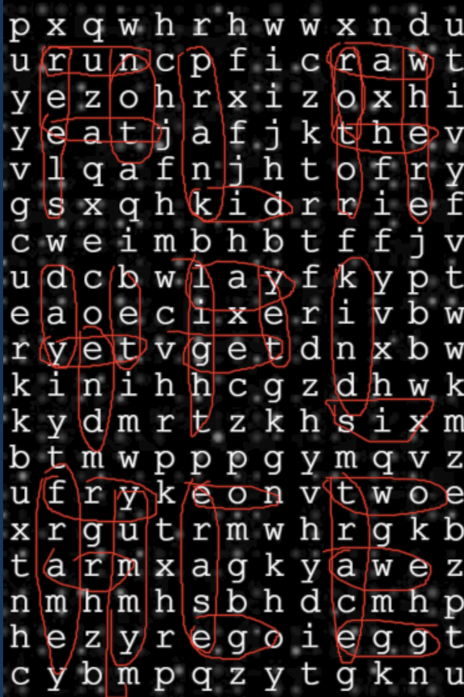

The outlines of the words on the crossword grid clearly spell out **playplace**.

***

<h3 id="puzzle-2">2 - Duology (5.8)</h3>

**Puzzle:** 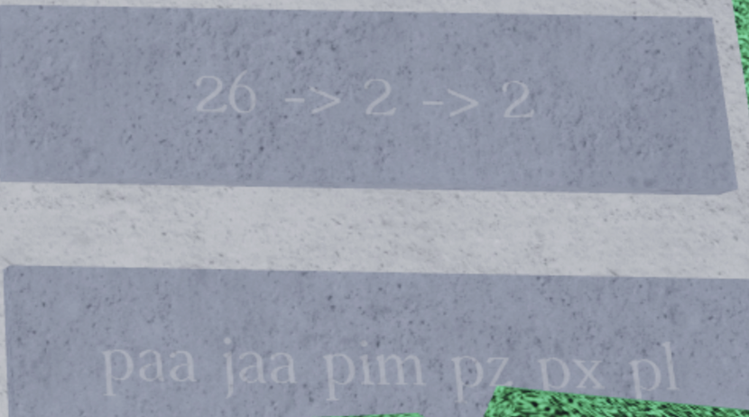

**Puzzle Answer:** euclid  

**Solution:** 

The 26 in the image refers to the fact that there are 26 letters in the alphabet, but it does not indicate A1Z26. The 2 -> 2 indicates a combination of a cipher with two inputs with another cipher which also has two inputs, such as morse or binary. We can combine all these clues to interpret the solution, which is to encode all character into morse code, concatenating them, replacing the dots with 0 and dashes with a 1, and decoding the 8-bit ascii. You can do this in [Cyberchef](https://gchq.github.io/CyberChef/#recipe=To_Morse_Code('-/.','Space','Line%20feed')Remove_whitespace(true,true,false,true,true,false)Substitute('.-','01',false)From_Binary('Space',8)&input=cGFhIGphYSBwaW0gcHogcHggcGw) to obtain the answer, **euclid**.

<h3 id="puzzle-3">3 - Trilogy (7.7)</h3>

**Puzzle:** [https://sanctuaryepoch.neocities.org/trilogy](https://sanctuaryepoch.neocities.org/trilogy) 

**Puzzle Answer:** wickpubjug  

**Solution:**

There are a few aspects of this puzzle. The two biggest clue here are the strings “Is enough to frame a world of color” and “Into the perfect image”. Here, we encode 3.081 (including the dot) into hexahue (as indicated by "Is enough to frame a world of color"), to obtain this:

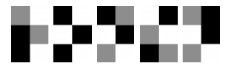

From here, we use the second part. THe "Into the perfect image" refers to Pictured as Perfect, which contains a custom-made cipher for it. 

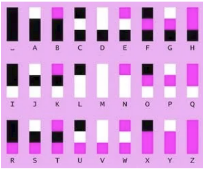

Decoding the hexahue with Pictured as Perfect cipher, you get bpcjukguwi, which is anagrammed to be **wickpubjug**.

<h3 id="puzzle-4">4 - LAEOCHELDRTXTE (6.3)</h3>

**Puzzle:** LAEOCHELDRTXTE (yes, that's it)

**Puzzle Answer:** emporiums

**Solution:**

So the puzzle content is literally just the name...The name is LAEOCHELDRTXTE, which is an anagram of PLACEHOLDERTEXT without the starting letter P. You know what else is a placeholder text? Lorem Ipsum. If you remove the first character just as how it was done to “PLACEHOLDERTEXT” to get “LACEHOLDERTEXT”, you get “orem ipsum”...and if you anagram oremipsum you get **emporiums**.

<h3 id="puzzle-5">5 - Articulation (5.2)</h3>

**Puzzle:** 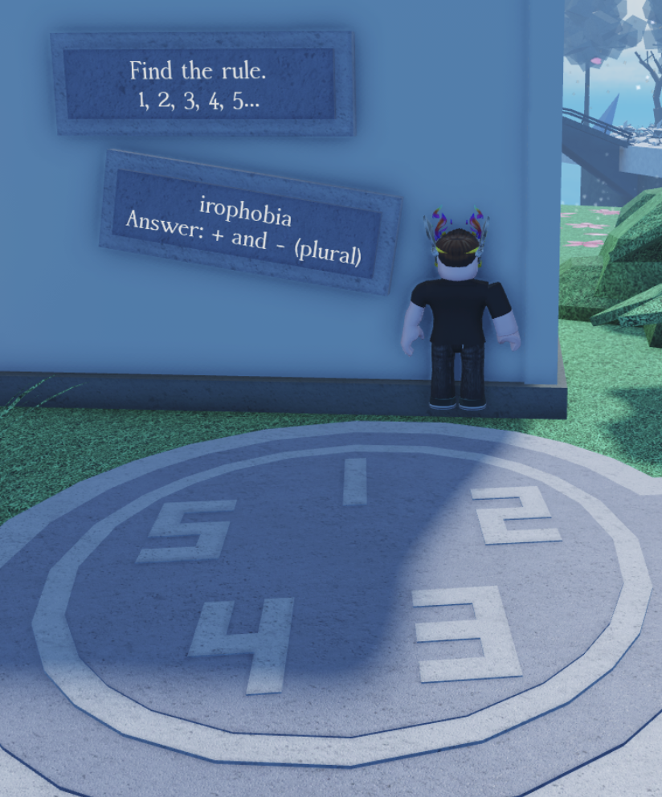

**Puzzle Answer:** dreamsandnightmares

**Solution:**

Find the rule here means find the pattern. 1, 2, 3, 4, 5 is basically adding one. One. One + irophobia, you get Oneirophobia. Oneirophobia is the fear of dreams and going to sleep. If you consider the + to be dreams, the - is nightmares. Thus, the answer is dreamsandnightmares.

<h3 id="puzzle-6">6 - Elements (5.0)</h3>

**Puzzle:** [https://sanctuaryepoch.neocities.org/elements ](https://sanctuaryepoch.neocities.org/elements) 

**Puzzle Answer:** hotfudgesundae

**Solution:**

The image shows a bunch of links between fire, air and water. This combined with the infinite logo and the puzzle’s title all leads to [infinite craft](https://neal.fun/infinite-craft/).

By simply following the links, and fusing the correct elements in Infinite Craft based on the icons, you will eventually reach a hotfudgesundae, which is the answer.

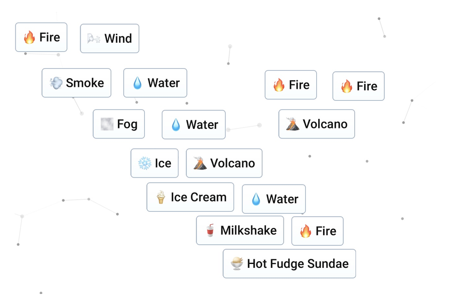

<h3 id="puzzle-7">7 - Onswer (5.3)</h3>

**Puzzle:** 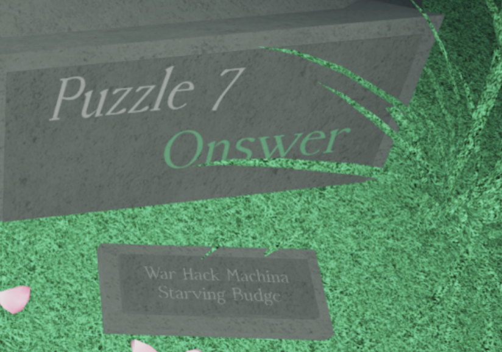

**Puzzle Answer:** trichloromethane

**Solution:**

“Onswer” (the puzzle title) is just “Answer” with one letter changed. I wonder if we can apply the same logic onto these words. 

Turns out, we can:

War -> Way
Hack -> Back
Machina -> Machine
Starving -> Starting
Budge -> Badge

The instructions are quite clear, use the wayback machine on the starting badge (“1 Puzzle completed”). We obtain [this](https://web.archive.org/web/20251216142239/https://www.roblox.com/badges/4060684560197810/1-Puzzle-Solved).

CH4 + Cl2 -> ???
⟳⟳ -> ANSWER (IN WORD)

CH4+ Cl2 produces chloromethane. If you repeat this reaction twice, you get chloroform, which is also **trichloromethane**. 

<h3 id="puzzle-8">8 - Golf (8.2)</h3>

**Puzzle:** [https://sanctuaryepoch.neocities.org/golf](https://sanctuaryepoch.neocities.org/golf) 

**Puzzle Answer:** raceperf

**Solution:**

Let’s look at the hint first, “what’s better than a hole in one stroke”. Well with the golf theming of the puzzle, you may think the hint is referring to something in golf, but that’s not the case here. 

The hint is actually talking about letters (hence the “stroke” part) with holes in them. Taking all undercased letters with holes in them will give us abdegopq, this matches up with the length of the text in the bottom left corner!

Taking hehgoqww as the “par” and deducting it with the text we got earlier in a1z26, give us the numbers 73428276. 

Now, we use the image. The image is of a game called Super Golf in Roblox. In Super Golf, scoring of under pars have their own names and the lowest under par you can go is 8, which matches with numbers! Taking the first letters of the names based on the amount under par in order gives us **raceperf**, which is the final answer.

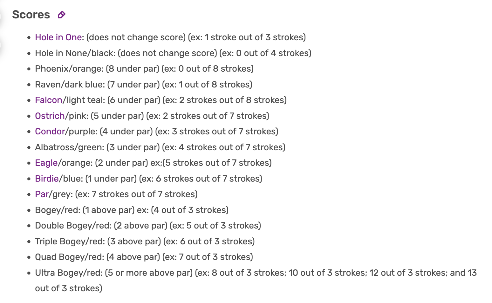

<h3 id="puzzle-9">9 - The Door (7.8)</h3>

**Puzzle:** [https://sanctuaryepoch.neocities.org/thedoor](https://sanctuaryepoch.neocities.org/thedoor) 

**Puzzle Answer:** whostherephosphene

**Solution:**

The image contains “knock knock”, which is referring to the famous “knock knock, who’s there” joke. The page tells us decoding the ciphertext with known ciphers wont help, but maybe we can try encoding a separate text. 

If you search “knock knock cipher” up, you can see the top results are actually tap code! Encoding “whosthere” in tap code using the most common grid (-J) gives:

..... ..  .. ...  ... ....  .... ...  .... ....  .. ...  . .....  .... ..  . .....

Which looks like nothing, until you overlay it with the text on the page:

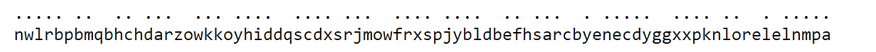

That’s weird, the spacing is different. If you extract all letters under singular spaces, you get the word phosphene!

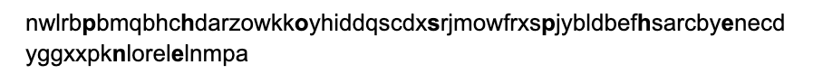

That isn't the final answer though, the page tells us that we gotta add what’s used to get the final answer before the actual final answer. This is obviously “whosthere”, meaning the final answer is **whostherephosphene**.

<h3 id="puzzle-10">10 - Snake (6.2)</h3>

**Puzzle:** [https://sanctuaryepoch.neocities.org/snake](https://sanctuaryepoch.neocities.org/snake) 

**Puzzle Answer:** polygenic

**Solution:**

Follow the rules:
- Reach the apple
- Make sure the path has minimal length and turns
- Make sure the position after the path does not result in death.

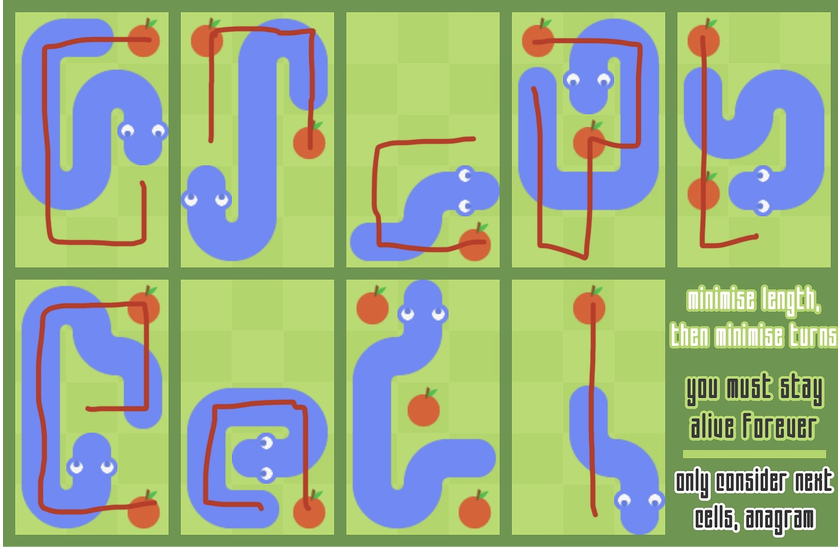

The paths of the snakes spell out letters, GNCPLEOYI, which anagrams to **polygenic**, which is the final answer. (GOD PLEASE IS THERE A BETTER IMAGE)

<h3 id="puzzle-11">11 - Literature (8.6)</h3>

**Puzzle:** [https://sanctuaryepoch.neocities.org/literature](https://sanctuaryepoch.neocities.org/literature) 

**Puzzle Answer:** imnotdyslexic

**Solution:**

The image refers to a library, and given the name of ‘bible.txt’, and the fact that bible.txt contains a really long string of gibberish, it clearly refers to the Library of Babel, an infinite library where any combination of text can be generated. However, we still need a Wall, Shelf, Volume and Page. The page tells us to ‘ask for the specifics’ and to ‘not disturb the others’. This is quite vague, but in a library people whisper to others. In Roblox, there's a chat command called /w, or /whisper in full form. Typing /whisper wall/shelf/volume/page shows the corresponding item.

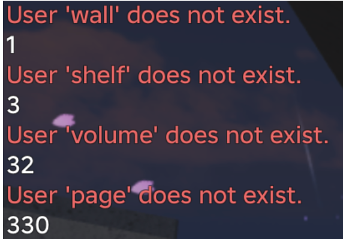

This leads to a [page](https://libraryofbabel.info/book.cgi?2ka3iq375a6aeo9dcchivtp98424a7mkar6shdsp5z43boigaooo4q43j9y66ekpr1f0wvanpnlxg5ng12koemrnud6o95xxqgrs5uyjtk3itjojqx6dluu9j8r4e3iyfzv4crv5ij8er34vq4nmscfi2yudkk48hokvdk6h1pesm1o7bbv8z7jxlgg2lcl40ravr4bkzsc12l8akhyqahmxuz7mv7z0bb5ftm7rcpbi7f2u99q88hlcmxnb1cfztgiwuu6eya2y4g2cneytq7z6d52c68pf94bgzhgp11kc1g4lxllghr36gl9ampqg38psbcwucl2gxxtg611optl5q7g3r07yrg6uci7szjqc3b5mcfc7d4kcdnxipy6d9d2ii8w7sv5phvr9k975ksuz1qeaigoi0rb4tfo8u5x6rikyib2mk1cckgl7owb0pm4hld7naerqbn8ya384h8q4q5tiwj1geha5gq225dxlqdsuc66ndvd8b7ljvcvej47v6w33aupw5qsxq2puql83fpt1x9v2qus1kb8ymkyi8dlh65nmeop8uy3i3qogswac9597gkeo26siidjw5oizkz1sf2n3y2m357k6d4ka7g51vs4ilqm76dvhfyysyr0hf1sdzry0gm6kpl9wln2kzsx9eaftn7a9zz2vg4y7xz6aokt28b8orbfz9a5p9me7ildjnspt194jhbiu029913uw2zbvx03m8fpg5tsaw1qhcjc1ep0eun5fgkipfiu59ny4o8mee7qemzt79s8jk2rj2mka57gsr1omxzaz1zjaty6a8d392wvt2nxuu8luj4tblji7n54252b1k6pcmjyeohbcwszotszpzvb197pg2zswgypui4d6txg69slqqy8q6iygwp0vjb5gjswb5w4qp2fazq0ydrqdf1qya843kyilx03rf240fobnz6rh5g60l86if0men42jdixd796vvdixqbk0g3x27ia08doemn64nzaxiu997i5lhx3vve7k3ml2p1cr1fvi9hn2trchv9n425l2tqia57shoflmwsnugcwuf80eqoarchgvtbw4o29l1cl39qgffm2bjnkwv39s9iimfj1s647c8b9omeon1qbr39ype6yc14yg7ka8q0mn3fcp8mc94p6q1p1o1m0omrncgy41kmeh5fz6b4wu12rawkh4gpxp1xgam86erpf95z6bvrwjft5kf37pq9e2gsngshpqmyzfcds5qypuuq32imyw8lugr95fi63580zwly6and57wvc4tc5191p7pjw8jh91jxtly2hbakdh3abv5nlms6ma9n03yv6pk8i7f5gsyh94cblldq8lap3k76kwjgp8tf6xaz2vg845z32y3ub7c0dk23av87uqkb9tucb7ttmgbl4v5190adbe1fcb2q063f6b2n33bnq31m4ha76oum3qwdr0e3tvhuzjozqgd2rp48raqa2dd605b3ymxr8zsnd0bhhyr8zybhjww2u33krdg47wg4pyrj876e3py3i0mwibcsvoo3tvcjo91fhslc3xioq1fq48ndfn4xr22kd8bg0l1cv7ph1aqpnpo51yhbw2hg93vgqd83drtumsq57kjv8bnxkfd2yrohjxzm7ybizc50or2hc36mk6f839hd83d48kbmygppsylmke5t8vnq8vkzp876tjsv5d59nhc5ij1aputll8d6kbljoh8wewocukk7w5ijoe7u80gvl74k9w6vszeduhh0mahri52xgdu9b7jm757eweszbyfrlfszvtfb31lp6u2r88nqx9vj2lim22gosapjuk1qsalblguthv9t38vlqmxm00fol46meb5vr7w76ib0395d3hss491quc7l476jzlhlhpze5850qu7ps1da02y6dskz21bnbfvjj788hwqo2eb66kzf7k4e35nnljs05p7cvxf0lcypfyi12n350laqafo3haplzpidfxpxzxx4t6lhg1ju4jcz7p4xpb31am2qi28voim9138v9tach4i83skl6u40ttx6xsyotx8pcz6ti65yhd17bl6wpptq9xe2h9bj1icj7lm8m1pe9ny0xyu8p8ui7yxqnf42i2gy52h6r3zc76z68zicn2wz8oq6fhv78gtc17r8uv9m6uepca4r72k1h0ddxbhe81qrtlz6ax36fklaieajjwe7xv10lowv61vkjj6yod1n0npdirde4z883qvr0pab18jzxse8zua23eshvv9u4r13t8a4zz4q9z28ih6ynmt7l12t2x975qcleomrr0c5o0xsiwc31nnvtqxf9x17zp17jzwe9bp9lhno8h364z9w9hf54f8h2ouaa3zipspt9dck6t0rentdwx0925lb39ov8cgfwmqnfib06350to5uxevu7eysz88xp2tin9w7u12uzr4g1z7915eackr4ez7sgddcuue97inpy0ybpcyi3lbl15g8evsqk9avbl97z5nl3yskt9pi0zx11n80d5arxdb2ir231gqfm805pdyiyfn67oxm3o1kthegsvsjr6z2otyr8vh3lg2kl4rr7c8mz7405i1jfkbgmsa10h5fzq6fweclmhrjd37cafvujf4f2096p1qdsg7jghvs576iacnepfpktbi2k48ierf9ungakekchmxjhqwg438gc60xgejlcbh7dvkfsmkt18mlnwqkh35kb39yx0g0m85g1i6x76l3pmf3299rtdpqdmg0s909souhe10ympsuhhlns3k6ja4pzf8ww2b84za8qeh5jkqhfpal8qgshajc5fg44v1o3po3hpia8ekrp9migifzmg1o23dstdhmm9eooblh0od0uns2humu9r104z071r3j9fphtb8ekqhyad5ra0y96ugvxxw02weyms6p28zmot7eafz3ath6viqtwi2gl7acj634w9qtb1natwq34lxf9xqskvphniydtybv7fzkqod15e8y1a5ly8d6wdoszfueblsd8kd09pie33v6jfs19hi433scadhw9ss77rbhbpiolrlg20dnewk9i1oq6ydma9vryttchrmqk3qv33113r3cdumiyrvdn5eja3oxwbn3z0bu5jyige26seki3nmhoddljjixa9mj9s47vvphdq0doe9742x86gcsv6t7pkih97rkvs9c6ik8tr6ij6zdqdmflgnlyltq-w1-s3-v32:330) in the library of babel. You get the following:

> keep reading qebvpsyaruxwtmsnfdijcloxy if you know what the cipher is, who said you had to find another text.

This text is quite misleading, but “reading” here refers to a book cipher! But what is the book text? “Keep” tells us to repeat the process multiple times, and the book text is actually itself!

Example: qebvpsyaruxwtmsnfdijcloxy => 17 5 2 … which you then index on to the same text to get “fpelniyqdcxojtimsvrubwsxy”. Repeat the same process to get imnotdyslexicudjrwvbpsrxy. Ignoring the gibberish, the answer is **imnotdyslexic**.

<h3 id="puzzle-12">12 - mayakovskaya (6.8)</h3>

**Puzzle:** [https://sanctuaryepoch.neocities.org/mayakovskaya](https://sanctuaryepoch.neocities.org/mayakovskaya) 

**Puzzle Answer:** circuitbracket

**Solution:**

The page gives quite a few clues for this one: 

“this is related to a game and nothing constructed in real life, and TWD as a whole is not an acronym”. 

The puzzle seems to be themed around metro stations, the title “mayakovskaya” is a metro station in Moscow. The ingame puzzle plate is also considerably smaller than other puzzle plates, you could say that it is pretty “mini”. One game related to metros that we can derive from the clues (yellow and pink lines in the image, the puzzle plate) is Mini Metro!

This part is quite vague but “T W D” refers to station types in Mini Metro! You can find them [here](https://mini-metro.fandom.com/wiki/Station), and the next step is clear. Trace these shapes on the ring of letters in the page:

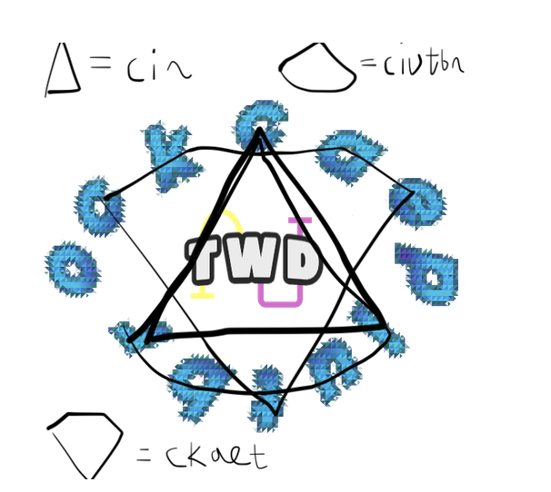

And you get CIRCIUTBRCKAET, which easily anagrams to **circuitbracket**, which is the final answer.

<h3 id="puzzle-13">13 - Hieroglyphs (6.8)</h3>

**Puzzle:** [https://sanctuaryepoch.neocities.org/hieroglyphs](https://sanctuaryepoch.neocities.org/hieroglyphs) 

**Puzzle Answer:** littleteeth

**Solution:**

So like, everything except the numbers is irrelevant.  Each numbers correlate to an amount of dashes in that direction, use it to draw letters.

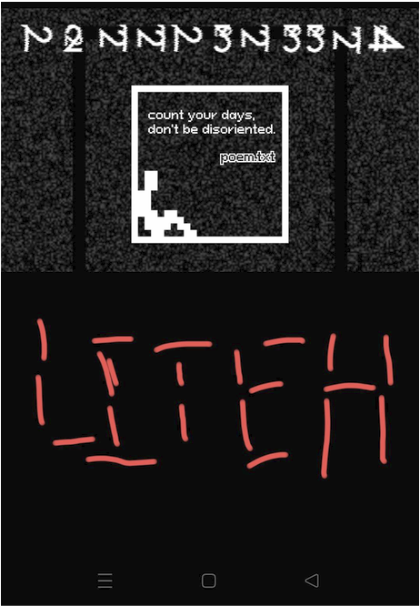

Substituting in the letters we get **“littleteeth”** as the final answer

<h3 id="puzzle-14">14 - Mosaic (6.3)</h3>

**Puzzle:** [https://sanctuaryepoch.neocities.org/mosaic](https://sanctuaryepoch.neocities.org/mosaic) 

**Puzzle Answer:** otherroute

**Solution:**

The image obviously references the pangram “The quick brown fox jumps over the lazy dog”. It is easier to proceed by splitting this pangram into two, one regarding the clue the fox gave, and one for the dog.

The quick brown fox | jumps over the lazy dog

Both animals have “forgotten the alphabet once”. This is a vague clue to remove all the letters that occur only one time for the whole sentence. This will result in the following:

> the u ro o | u oer the o 

The fox “forgets you completely”, this suggests removing the letter ‘u’ from the fox’s side of the sentence as if you simply pronounce ‘you’, that yields the letter u. The dog “forgets how to climb ladders”, this suggests removing the letter ‘h’ from the dog’s side of the sentence as the letter ‘H’ looks like a ladder when capitalized. Doing this gives:

> the ro o | u oer te o 

Now remove duplicated letters from each side as instructed in the webpage:

> thero | uoert 

Anagram each word:

> other | route

Therefore, our answer is **otherroute**

<h3 id="puzzle-15">15 - Happy Home (7.8)</h3>

**Puzzle:** [https://sanctuaryepoch.neocities.org/happyhome](https://sanctuaryepoch.neocities.org/happyhome) 

**Puzzle Answer:** boysdaybooks

**Solution:**

One thing assigned to a player when their account is made (birth) is their chat colors! Using [this site](https://ryloriz.github.io/rblx-name-color/) (use v1, you’ll understand why in a bit), you can get the chat color of any username! You apply this to the random words in the image. Then, since this is a reference to old roblox (“happy home”, as well as “time reversed”), all these colors are actually present in the DYNABLOCKS logo. Extract the letters (if two are the same color, extract both)

“Imagine” -> Bright red -> K,D 
“Dont” -> Bright violet -> O 
“Know” -> Bright Yellow -> B 
“What” -> Earth Green -> S,Y 
“Do” -> Bright Violet -> O 
“Think” -> Bright Orange -> A 
“If” -> Bright Yellow -> B 
“Time” -> Bright violet -> O 
“Reversed” -> Dark Green -> S,Y 

Which yields:

> KDOBSYOABOSY

Use the given anagram guide in the page: 

>>> BBBBBBBBAAAA 
>>> KDOBSYOA BOSY 
>>> DAYBOOKS BOYS 
>>> AAAA-BBBBBBBB  

Thus, we obtain **boysdaybooks**, which is the final answer

